<h1 align="center"><a href="https://stud-aura.vercel.app/">StudAura</a></h1>

<p align="center"><a href="https://stud-aura.vercel.app/"><b>Live app: stud-aura.vercel.app</b></a></p>

<p align="center"><b>Watch. Capture. Track. Revise.</b><br>
A dark-only, YouTube-inspired personal learning workspace, delivered through a complete DevSecOps pipeline.</p>

<p align="center">
<a href="https://github.com/Avishkar74/StudAura/actions/workflows/ci.yml"></a>
<a href="https://stud-aura.vercel.app/"></a>


</p>

<p align="center">
<a href="https://stud-aura.vercel.app/">Live app</a> ·
<a href="#what-the-app-does">The app</a> ·
<a href="#architecture">Architecture</a> ·
<a href="#run-it-locally">Run locally</a> ·
<a href="#cicd">CI/CD</a> ·
<a href="#infrastructure-and-kubernetes">Infrastructure</a> ·
<a href="#verification-and-evidence">Evidence</a> ·
<a href="#known-issues-and-limitations">Limitations</a> ·
<a href="StudAura-Capstone-App-and-DevOps-presentation.pdf">Slides</a> ·
<a href="SUBMISSION.md">Submission guide</a>
</p>

Organise YouTube videos and playlists into learning paths, watch them embedded, take notes, track
progress, set daily goals and manage a revision queue. It is also a DevOps capstone: Docker, GitHub
Actions, Trivy, GHCR, Terraform, EKS, Helm, ArgoCD, Prometheus and Grafana are all part of the
project.

**Start here:** the [slide deck (PDF)](StudAura-Capstone-App-and-DevOps-presentation.pdf) and the [submission guide](SUBMISSION.md), which maps every graded item to its files and screenshots.

<p align="center">
<a href="docs/screenshots/landing-desktop.png">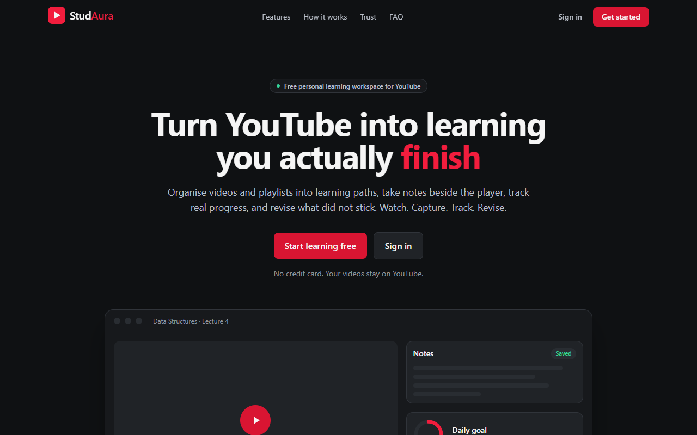</a>
</p>

## What the app does

| Area | What you can do |
|---|---|
| Learning paths | Create, rename and delete paths; import single videos or whole playlists (partial failures are reported per item). |
| Player | Embedded YouTube player (IFrame API only), resume where you left off, learning status kept separate from playback position. |
| Notes | Rich-text notes per video with 1.5 s autosave, a Saving / Saved / error state and retry; a conflicting edit from another tab is detected, never overwritten. |
| Comments | Timestamped comments on a video. |
| Goals | A daily watch-time goal driven by observed playback intervals only. |
| Revision | Flag a video for revision, reschedule, mark revised. |
| Library | Saved videos outside any path. |

Sign-up and sign-in use Supabase Auth. The backend never trusts a user id from the client: it takes
it from the verified token and filters every query by it.

## Architecture

```
Browser ──► Ingress (nginx) ─┬─ /          ──► frontend  (nginx, React SPA)       ×2
                             └─ /api ...   ──► backend   (FastAPI)                ×2 ──► PostgreSQL (Supabase)
                                                  │  /metrics
                                   Prometheus ◄───┘──► Grafana (/grafana)

GitHub ► Actions: lint + tests + build ► Trivy ► GHCR (SHA tags) ► `deploy` branch ► ArgoCD ► EKS
```

| Layer | Technology |
|---|---|
| Frontend | React, Vite, TypeScript, Tailwind CSS v4, TanStack Query, TipTap |
| Backend | FastAPI, SQLAlchemy 2 (async), Alembic, python-jose (JWT/JWKS), nh3 |
| Data | PostgreSQL (Supabase in the cloud, a container locally) |
| Delivery | Docker (multi-stage, non-root), GitHub Actions, Trivy, GHCR, Terraform, Helm, ArgoCD (GitOps), EKS |
| Observability | `prometheus-fastapi-instrumentator`, kube-prometheus-stack, Grafana |

REST API under `/api/v1`: `me`, `learning-paths`, `videos`, `playlists`, `notes`, `comments`,
`goals`, `revisions`, `library`, `dashboard`, `viewing-sessions`, each with GET, POST, PUT/PATCH and
DELETE where it makes sense. Interactive docs at `/docs` when running locally. Probes: `/health`
(liveness), `/ready` (checks the database), `/metrics` (Prometheus).

## Run it locally

```bash
cp .env.example .env        # fill in the Supabase and YouTube values (see Supabase setup)
docker compose up --build   # postgres + migrations + backend + frontend
```

| URL | What |
|---|---|
| http://localhost:5173 | Frontend |
| http://localhost:8000/health | Liveness |
| http://localhost:8000/ready | Readiness (checks the DB) |
| http://localhost:8000/metrics | Prometheus metrics |
| http://localhost:8000/docs | OpenAPI docs |

Compose always uses its own local Postgres, whatever `DATABASE_URL` says in `.env` (that value is
for running against Supabase). Migrations run as a one-shot `migrate` service, never in every
replica.

### Supabase setup

1. Create a project and copy the URL and anon key into `.env` (`VITE_SUPABASE_URL`,
   `VITE_SUPABASE_ANON_KEY`).
2. Authentication > Providers > Email is on by default. With "Confirm email" on, new users get a
   confirmation link before they can sign in (the built-in mailer is rate limited; turn
   confirmation off for development if you hit the limit).
3. Add the site URL under Authentication > URL Configuration (for a deployment, its address plus
   `/**` under Redirect URLs).
4. The backend verifies tokens against the project's public JWKS, so no JWT secret is needed on
   projects using asymmetric signing keys.

## Tests and code quality

```bash
docker compose exec backend pytest -v                 # backend: unit, API, database, migrations
docker compose exec backend sh -c "ruff check . && ruff format --check . && mypy ."

cd frontend && nvm use && npm ci                      # Node 24 (see .nvmrc)
npm run lint && npm run typecheck && npm test         # ESLint, tsc, Vitest (425 tests)
npm run e2e                                           # Playwright + axe accessibility (see below)
```

* **674 backend tests pass** (656 in the captured [`pytest -v` run](docs/evidence/pytest-v.txt); the rest cover later features).
* Backend tests use a **throwaway PostgreSQL database** created per test run (never the real
  one) and a **fake YouTube adapter** with recorded fixtures, so CI never calls the YouTube API.
  The Alembic migration test upgrades from an empty database. Config: `backend/pytest.ini`,
  shared fixtures in `backend/tests/conftest.py`. Dependencies are declared in
  `backend/pyproject.toml`.
* End-to-end: `frontend/e2e` runs Playwright on desktop and a phone viewport and scans pages with
  axe for WCAG 2 A/AA violations. The signed-out specs run anywhere; the signed-in specs run when
  `E2E_EMAIL` and `E2E_PASSWORD` for a test account are set. `E2E_BASE_URL` points it at a
  deployment, `E2E_CHANNEL=chrome` uses an installed Chrome.

## Docker

* `backend/Dockerfile`: multi-stage; the `runtime` image runs as UID 10001, the `dev` stage adds
  the test tooling.
* `frontend/Dockerfile`: multi-stage (Node build, then `nginx-unprivileged` on 8080, non-root).
  `VITE_*` values are baked in at build time, which is why the CI publish step takes them from
  repository variables.

## CI/CD

One workflow, [`.github/workflows/ci.yml`](.github/workflows/ci.yml); details in
[`docs/CICD.md`](docs/CICD.md).

| Job | When | What |
|---|---|---|
| backend, frontend | PR, main | ruff, mypy, pytest (fails on any skipped test) and ESLint, Prettier, tsc, Vitest, build |
| terraform, helm | PR, main | fmt, validate, plan tests, `helm lint --strict`, render, Trivy misconfiguration scan |
| images | PR, main | build both images, check non-root, smoke test |
| publish | main | Trivy scan (a fixable HIGH or CRITICAL blocks), push to GHCR **tagged with the commit SHA only** |
| gitops | main | writes that SHA to the `deploy` branch, which ArgoCD watches and syncs to the cluster |
| e2e | main | Playwright and axe against the production bundle |

Security: images are scanned with Trivy before they are pushed and a fixable HIGH or CRITICAL blocks the push; third-party actions are pinned to
commit SHAs; secrets are never in Git (`.gitignore` covers `.env`, `*.pem`, `*.tfvars`, state).

## Infrastructure and Kubernetes

| Path | What |
|---|---|
| [`deploy/terraform`](deploy/terraform/README.md) | VPC with public and private subnets, EKS cluster, managed node group, add-ons; `terraform.tfvars.example`; plan tests run in CI without AWS credentials |
| [`k8s`](k8s) | `namespace.yaml` (Pod Security labels) |
| [`argocd`](argocd) | Argo CD values and the `Application` that syncs `helm/studaura` from the `deploy` branch (automated, prune, self-heal) |
| [`helm/studaura`](helm/studaura) | Chart: backend and frontend Deployments (2 replicas, HPA, anti-affinity, non-root, read-only root filesystem, probes), ClusterIP Services, Ingress (`/` to the frontend, `/api` to the backend), PodDisruptionBudgets, an Alembic hook Job, and optional ServiceMonitor, alert rules and Grafana dashboard |
| [`monitoring`](monitoring/README.md) | kube-prometheus-stack values; Grafana is served under `/grafana` |
| [`deploy/ec2`](deploy/ec2/README.md) | The same app on a single EC2 instance with Docker Compose, for accounts that cannot create an EKS cluster |
| [`frontend/vercel.json`](frontend/vercel.json) | Public hosting: the frontend on Vercel, `/api` proxied to the EC2 backend, see [`docs/VERCEL.md`](docs/VERCEL.md) |

Deploy to a cluster by hand (ArgoCD does the same thing automatically, see [`docs/CICD.md`](docs/CICD.md)):

```bash
kubectl apply -f k8s/namespace.yaml
kubectl -n studaura create secret generic studaura-secrets \
  --from-literal=DATABASE_URL=... --from-literal=SUPABASE_URL=... --from-literal=YOUTUBE_DATA_API_KEY=...
helm upgrade --install ingress-nginx ingress-nginx/ingress-nginx -n ingress-nginx --create-namespace
helm upgrade --install studaura helm/studaura -n studaura \
  --set image.tag=<commit-sha> --set backend.config.CORS_ORIGINS=http://<load-balancer-dns> \
  --set monitoring.enabled=true
kubectl -n studaura get pods,svc,ingress && helm list -n studaura
```

The chart refuses to render without `image.tag`, so a deploy can never fall back to a moving tag.
**Cost warning:** a running EKS cluster with nodes and a load balancer bills by the hour. Uninstall
the ingress controller first (its load balancer blocks deleting the VPC), then run
`terraform destroy`. The cluster used for the evidence below has been destroyed this way.

## Verification and evidence

Everything below was produced from this repository on a cluster built by `terraform apply`
(Sydney, `ap-southeast-2`) and has since been torn down with `terraform destroy`. Click an image
to open it full size. The map from each rubric item to its files is in
[`SUBMISSION.md`](SUBMISSION.md); raw command output is in [`docs/evidence`](docs/evidence).

| Check | Result |
|---|---|
| Backend tests | **674 passed** (656 in the captured run), [`pytest -v`](docs/evidence/pytest-v.txt) |
| Frontend tests | **425 passed** (Vitest); Playwright + axe: 12 passed against the cluster |
| `docker compose up --build` | db, migrate, backend, frontend up, [output](docs/evidence/docker-compose.txt) |
| Images in GHCR | commit-SHA tags only, [list](docs/evidence/ghcr-tags.txt) |
| Trivy | both images clean at HIGH and CRITICAL, [summary](docs/evidence/trivy.txt) |
| Terraform | **35 resources** applied and destroyed: VPC, 2 public + 2 private subnets, NAT, EKS, node group, add-ons, [state](docs/evidence/terraform.txt) |
| Kubernetes | 2 backend + 2 frontend pods Running, ClusterIP Services, Ingress, HPAs, [output](docs/evidence/kubernetes.txt) |
| ArgoCD | `studaura` Synced and Healthy, running the latest commit's images, [output](docs/evidence/argocd.txt) |
| Prometheus | 2 of 2 backend targets UP, [output](docs/evidence/observability.txt) |

#### Running application

<table>
<tr>
<td valign="top"><a href="docs/screenshots/app-localhost-3000.png"></a><br><sub><b>Docker Compose, localhost:3000</b></sub></td>
<td valign="top" rowspan="2"><a href="docs/screenshots/app-signup-mobile.png">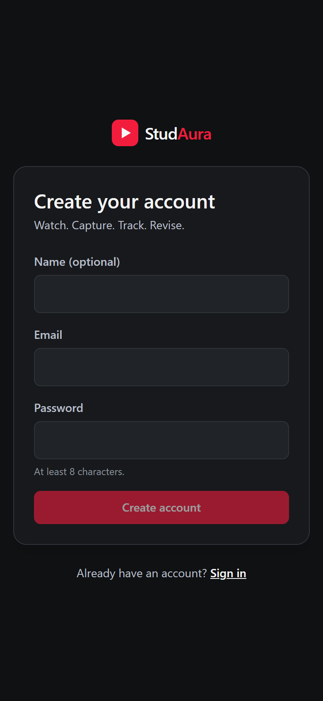</a><br><sub><b>Phone-sized screen</b></sub></td>
</tr>
<tr>
<td valign="top"><a href="docs/screenshots/app-login-via-ingress.png">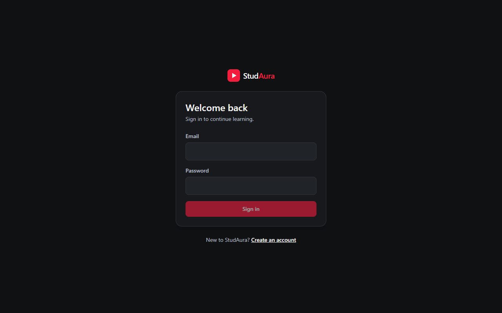</a><br><sub><b>Through the EKS Ingress load balancer</b></sub></td>
</tr>
</table>

#### Tests and containers

<table>
<tr>
<td valign="top" width="50%"><a href="docs/screenshots/terminal-pytest.png">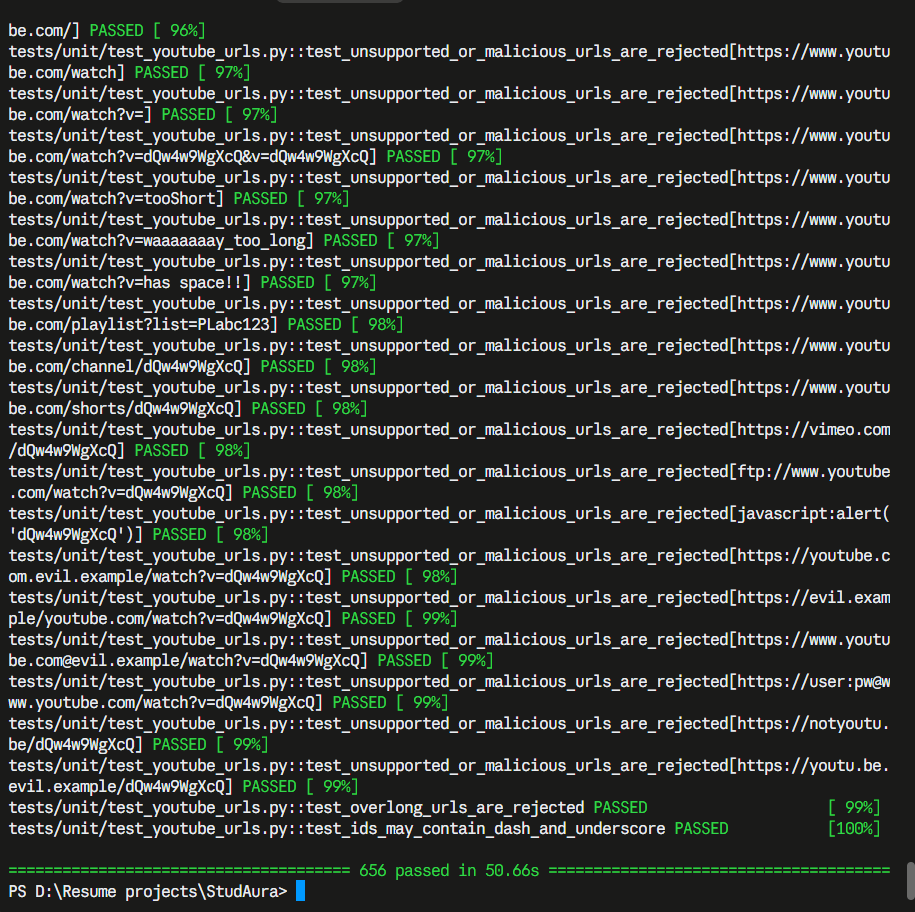</a><br><sub><b>pytest -v: 656 passed (captured run)</b></sub></td>
<td valign="top" width="50%"><a href="docs/screenshots/terminal-compose-up.png">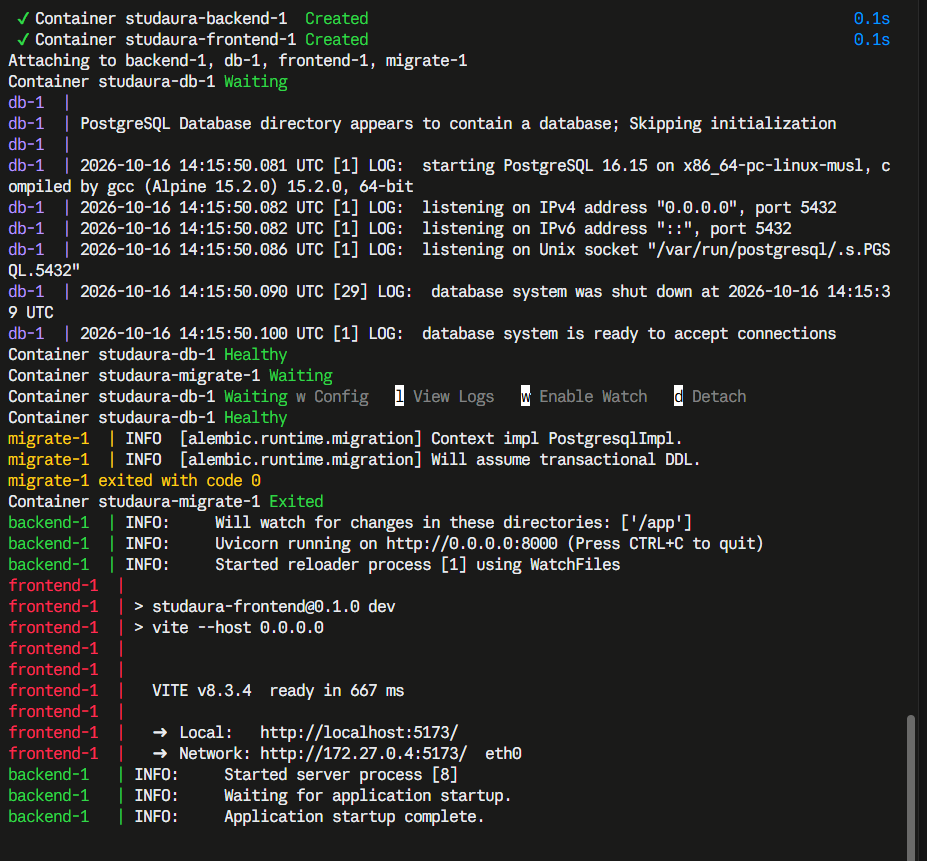</a><br><sub><b>docker compose up --build</b></sub></td>
</tr>
</table>

#### CI/CD, registry and Git history

<table>
<tr>
<td valign="top" width="50%"><a href="docs/screenshots/github-actions-run.png">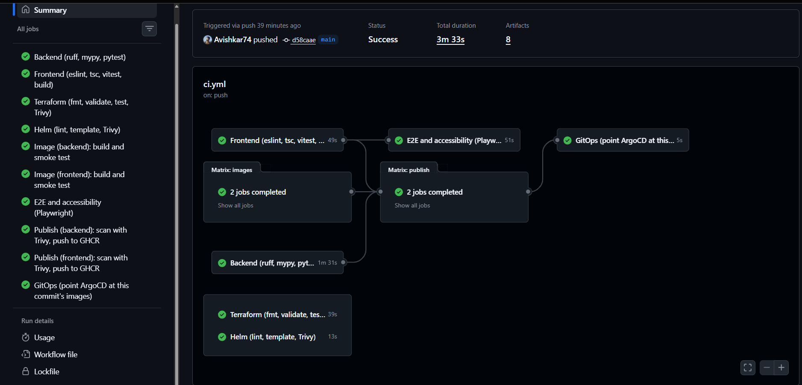</a><br><sub><b>Green pipeline run on main</b></sub></td>
<td valign="top" width="50%"><a href="docs/screenshots/github-actions-runs.png">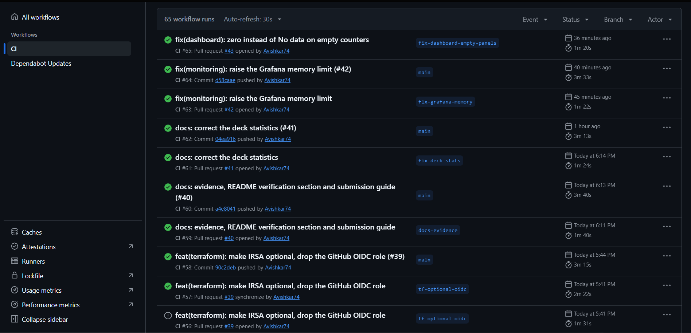</a><br><sub><b>Recent CI runs</b></sub></td>
</tr>
</table>

<table>
<tr>
<td valign="top" width="34%"><a href="docs/screenshots/ghcr-backend.png">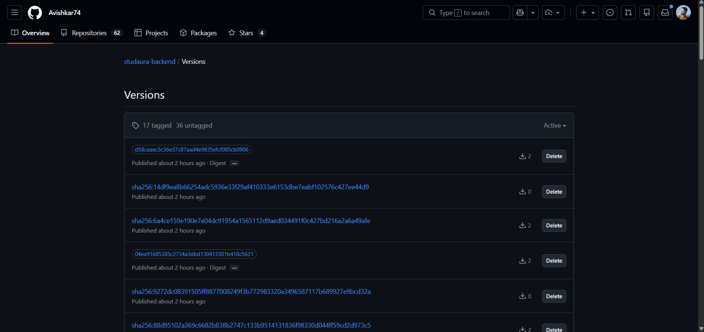</a><br><sub><b>GHCR: studaura-backend, SHA tags</b></sub></td>
<td valign="top" width="33%"><a href="docs/screenshots/ghcr-frontend.png">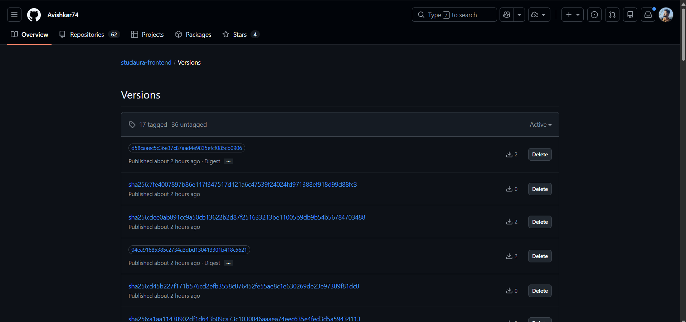</a><br><sub><b>GHCR: studaura-frontend, SHA tags</b></sub></td>
<td valign="top" width="33%"><a href="docs/screenshots/commit-history.png">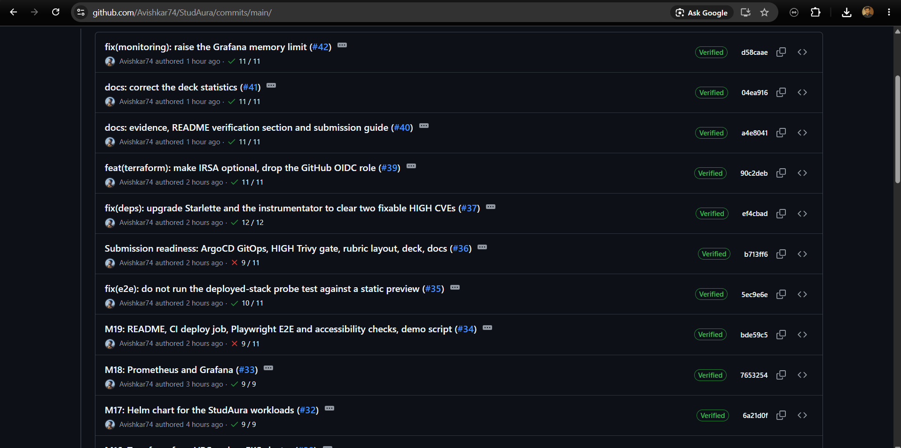</a><br><sub><b>Commit history</b></sub></td>
</tr>
</table>

#### Security: Trivy

<table>
<tr>
<td valign="top" width="50%"><a href="docs/screenshots/github-trivy-gate.png">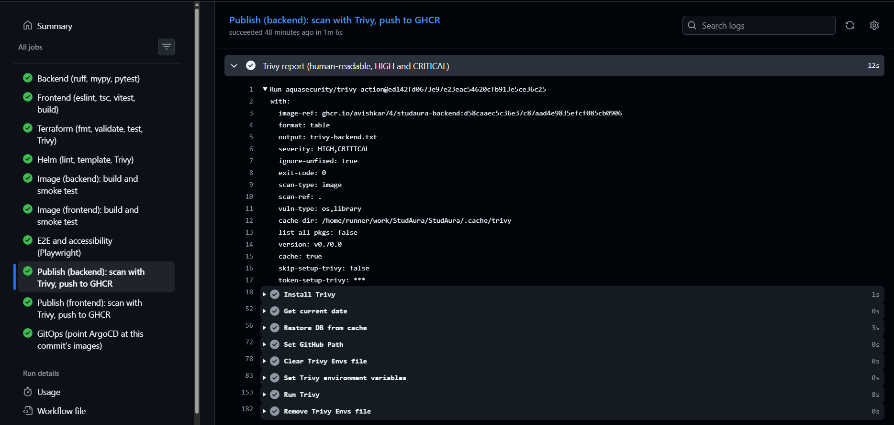</a><br><sub><b>Trivy step: image, severity HIGH,CRITICAL, ignore-unfixed</b></sub></td>
<td valign="top" width="50%"><a href="docs/screenshots/github-trivy-run.png">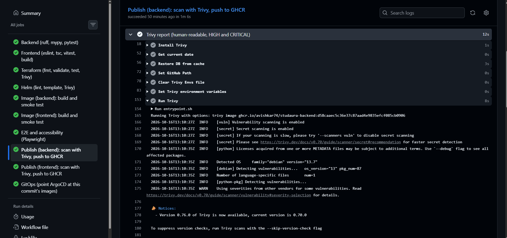</a><br><sub><b>Scan running against the pushed image</b></sub></td>
</tr>
<tr>
<td valign="top" width="50%"><a href="docs/screenshots/trivy-report-backend.png">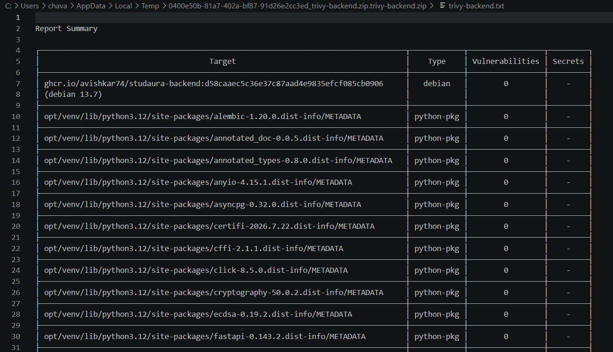</a><br><sub><b>Backend report: 0 vulnerabilities</b></sub></td>
<td valign="top" width="50%"><a href="docs/screenshots/trivy-report-frontend.png">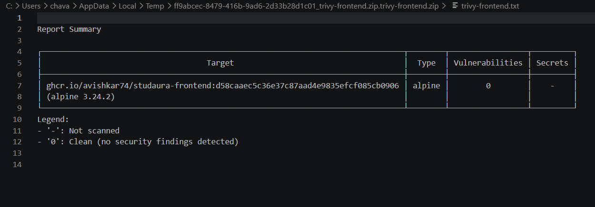</a><br><sub><b>Frontend report: 0 vulnerabilities</b></sub></td>
</tr>
</table>

#### Infrastructure: Terraform on AWS (Sydney)

<table>
<tr>
<td valign="top" width="50%"><a href="docs/screenshots/aws-vpc.png">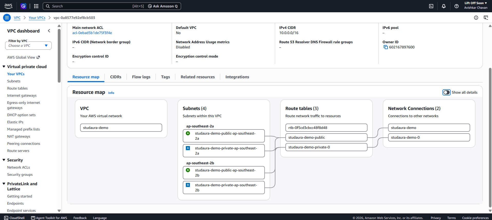</a><br><sub><b>VPC resource map: 2 public + 2 private subnets</b></sub></td>
<td valign="top" width="50%"><a href="docs/screenshots/aws-subnets.png">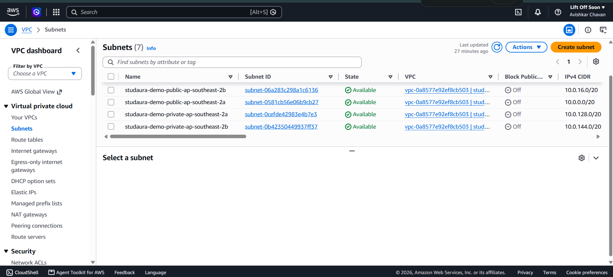</a><br><sub><b>Subnets in two availability zones</b></sub></td>
</tr>
<tr>
<td valign="top" width="50%"><a href="docs/screenshots/aws-eks-cluster.png">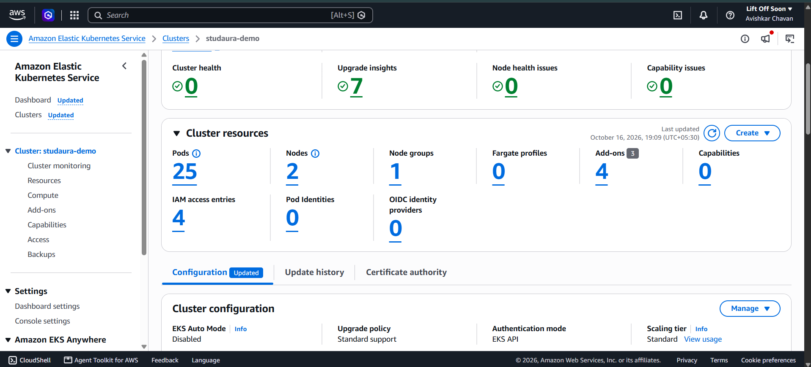</a><br><sub><b>EKS cluster studaura-demo</b></sub></td>
<td valign="top" width="50%"><a href="docs/screenshots/aws-eks-nodegroup.png">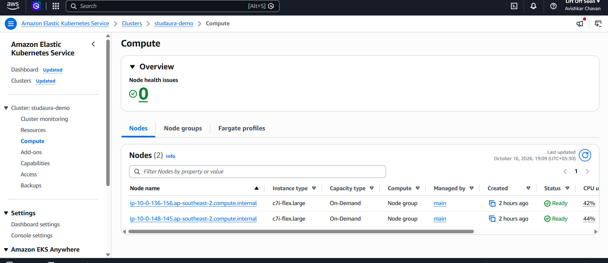</a><br><sub><b>Node group: 2 x c7i-flex.large, Ready</b></sub></td>
</tr>
<tr>
<td valign="top" width="50%"><a href="docs/screenshots/terraform-plan.png">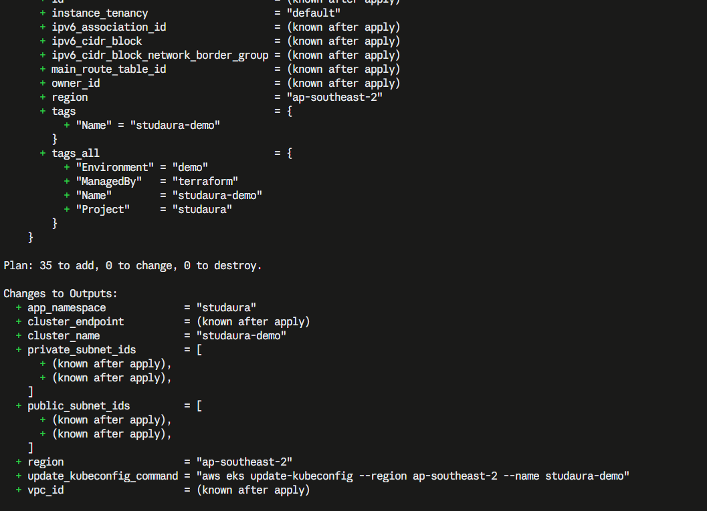</a><br><sub><b>terraform plan: 35 to add</b></sub></td>
<td valign="top" width="50%"><a href="docs/screenshots/terraform-destroy.png">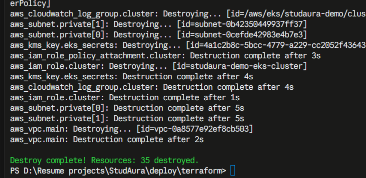</a><br><sub><b>terraform destroy: 35 destroyed</b></sub></td>
</tr>
</table>

#### Kubernetes and GitOps (ArgoCD)

<table>
<tr>
<td valign="top" width="50%" rowspan="2"><a href="docs/screenshots/terminal-kubectl.png">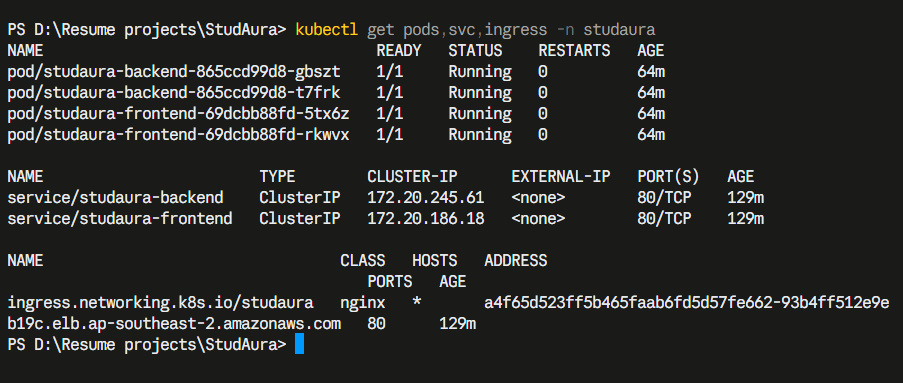</a><br><sub><b>kubectl get pods,svc,ingress -n studaura</b></sub></td>
<td valign="top" width="50%"><a href="docs/screenshots/terminal-helm.png">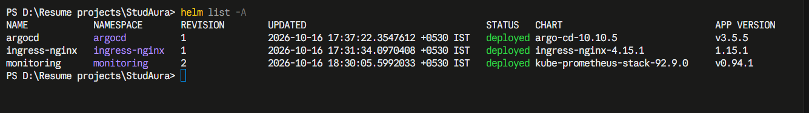</a><br><sub><b>helm list -A</b></sub></td>
</tr>
<tr>
<td valign="top"><a href="docs/screenshots/terminal-argocd-app.png">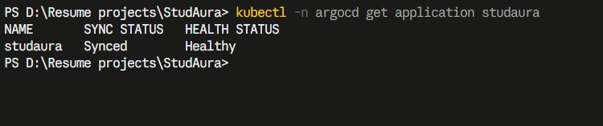</a><br><sub><b>ArgoCD application: Synced, Healthy</b></sub></td>
</tr>
</table>

<table>
<tr>
<td valign="top" width="34%"><a href="docs/screenshots/argocd-applications.png">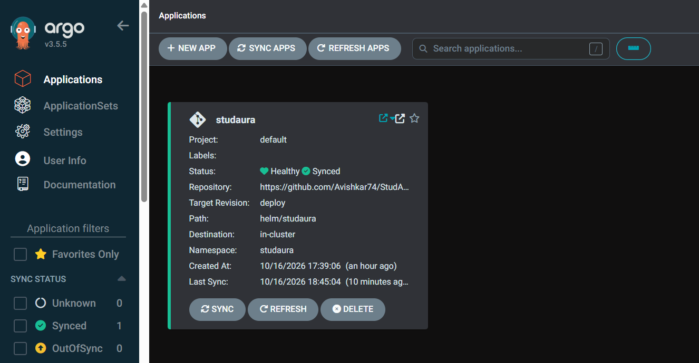</a><br><sub><b>ArgoCD applications</b></sub></td>
<td valign="top" width="33%"><a href="docs/screenshots/argocd-application.png">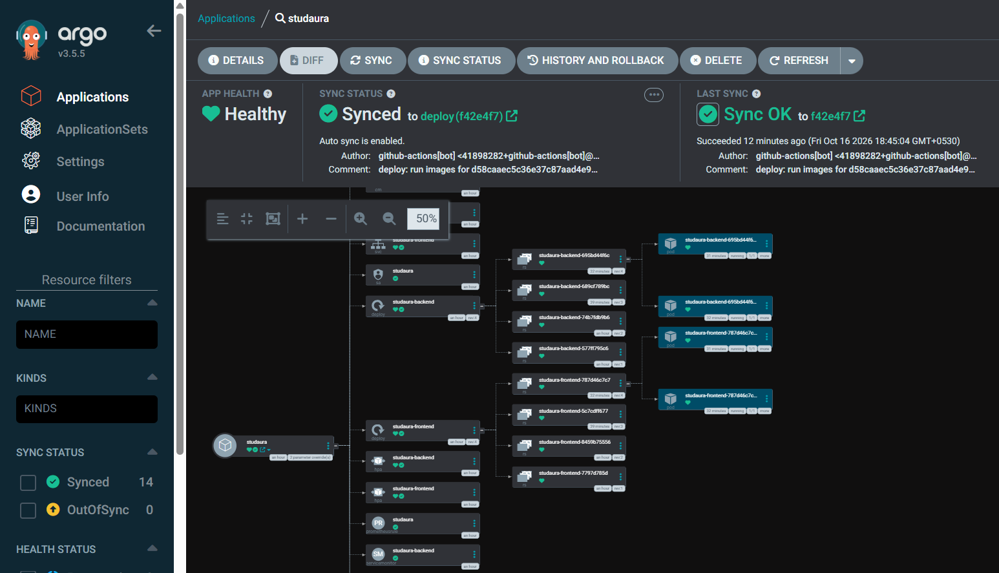</a><br><sub><b>Resource tree</b></sub></td>
<td valign="top" width="33%"><a href="docs/screenshots/argocd-details.png">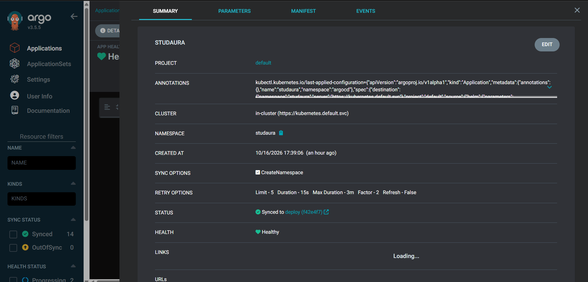</a><br><sub><b>Source: deploy branch</b></sub></td>
</tr>
</table>

#### Observability: Prometheus and Grafana

<table>
<tr>
<td valign="top" width="50%"><a href="docs/screenshots/prometheus-targets.png">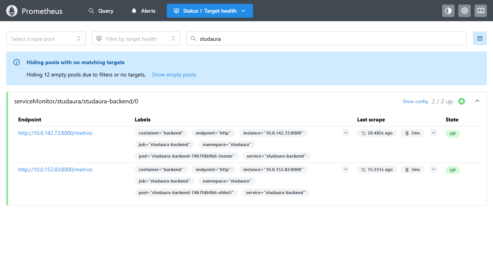</a><br><sub><b>Targets: 2 of 2 UP</b></sub></td>
<td valign="top" width="50%"><a href="docs/screenshots/prometheus-http-requests.png">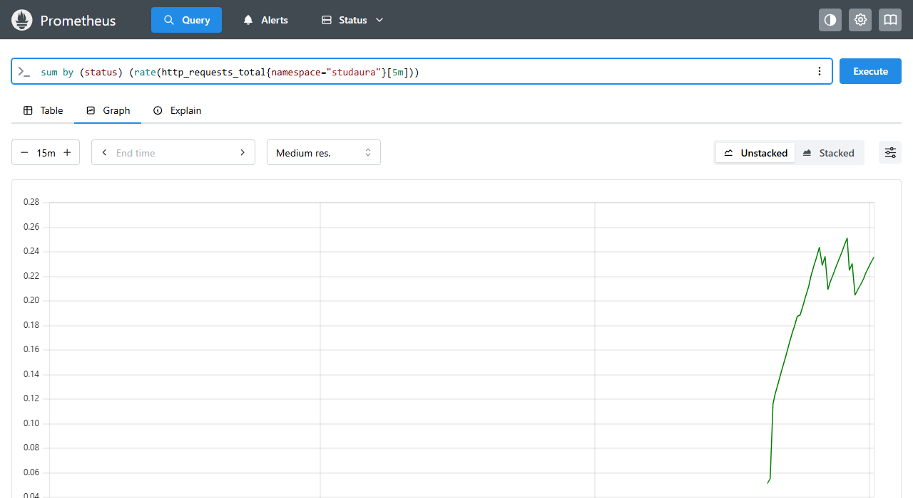</a><br><sub><b>Live request rate by status class</b></sub></td>
</tr>
<tr>
<td valign="top" width="50%"><a href="docs/screenshots/backend-metrics.png">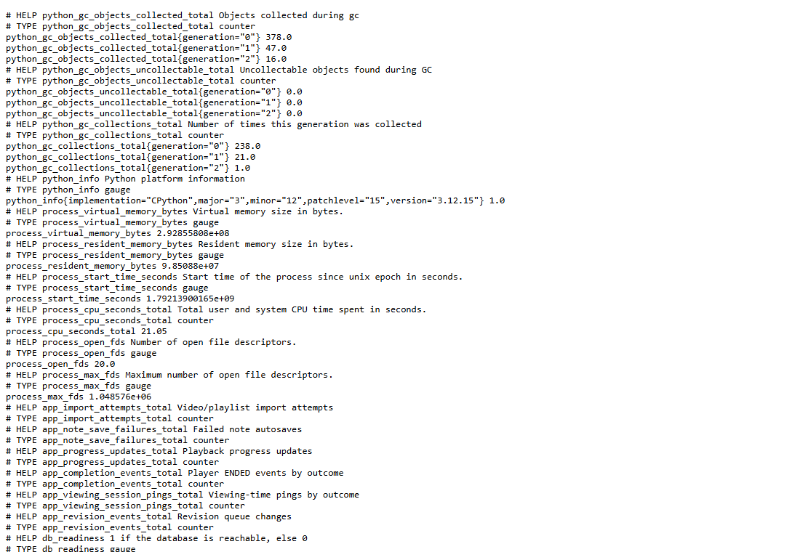</a><br><sub><b>/metrics in the browser</b></sub></td>
<td valign="top" width="50%"><a href="docs/screenshots/terminal-metrics.png">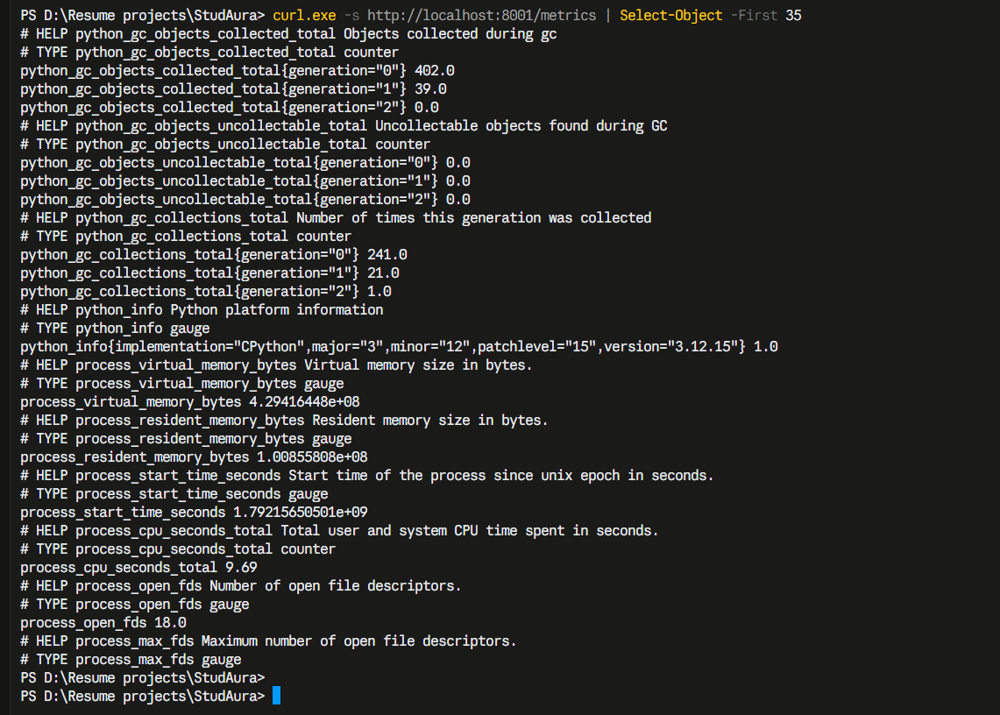</a><br><sub><b>/metrics with curl</b></sub></td>
</tr>
</table>

<table>
<tr>
<td valign="top"><a href="docs/screenshots/grafana-dashboard.png">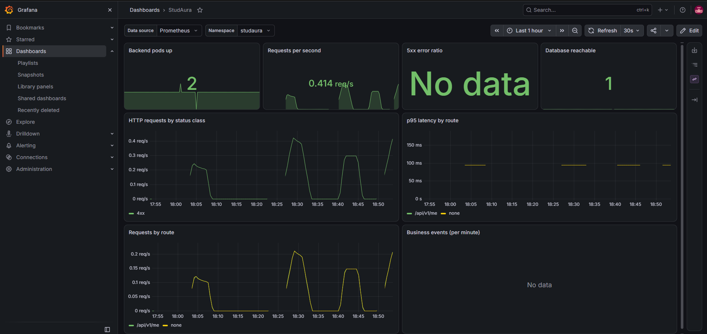</a><br><sub><b>Grafana dashboard StudAura: pods up, request rate, database, latency by route</b></sub></td>
</tr>
</table>

The Grafana dashboard source is
[`helm/studaura/dashboards/studaura.json`](helm/studaura/dashboards/studaura.json): pods up,
requests per second, 5xx ratio, database reachable, status classes, p95 latency by route, requests
by route and business events.

## Known issues and limitations

* **HTTP only.** The Ingress serves plain HTTP on the load balancer's DNS name; there is no
  domain or certificate. Supabase accepts an `http://` site URL, but a production setup would add
  cert-manager and a domain.
* **Region latency.** The database is a Supabase project in Mumbai; the cluster runs in Sydney, so
  every query pays about 260 ms. The backend tolerates it (a longer readiness timeout and a pool
  warm-up) but pages are slower than they would be next to the database.
* **Prometheus data is ephemeral.** No persistent volumes are configured, so metrics are lost
  when the Prometheus pod moves; Grafana dashboards are provisioned from Git and survive.
* **No automatic rollback of data.** Rollbacks restore the previous image; Alembic migrations are
  forward-only.
* **Supabase free tier** limits sign-up e-mails; confirmation can be turned off for a demo.
* **No live deployment.** To keep AWS costs down the cluster was destroyed after the evidence was
  captured; the Terraform and Helm steps above recreate it in about 30 minutes.
* The signed-in E2E specs need a test account and are skipped in CI.

## Environment variables

See [`.env.example`](.env.example). Secrets (`SUPABASE_JWT_SECRET`, `DATABASE_URL`,
`YOUTUBE_DATA_API_KEY`) are backend-only and must never reach the frontend bundle or Git.
